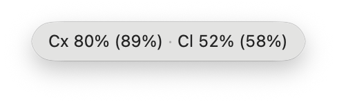
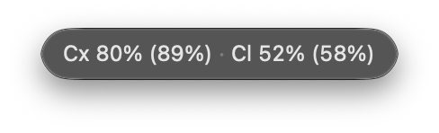

# Allowance Bar

A tiny macOS menu bar app (no Dock icon) that keeps your AI coding usage limits
visible at a glance — Codex/ChatGPT, Cursor, Claude
Code, and Gemini (one or several accounts each), Claude API spending and token usage, plus pay-as-you-go balances for OpenRouter, DeepSeek, Kimi,
Z.ai, and Venice — with a dropdown showing detailed meters, reset countdowns,
and balances. Keep every limit on screen in a floating window that stays
above your work, full size, as a compact mini panel, or as a nano panel with
just the menu bar text. Your coding agents can
read the same numbers through a small read-only CLI.

<a href="https://www.buymeacoffee.com/gilitos92">
  
</a>

If Allowance Bar saves you from a surprise rate limit, a coffee is always
appreciated. Entirely optional.

## Why Allowance Bar

| App view | Light mode | Dark mode |
|---|---|---|
| Menu bar dropdown |  |  |
| Full window |  |  |
| Mini window |  |  |
| Nano window |  |  |

**A floating usage window that stays where you can see it.** Most usage
meters live only in the menu bar: you click, look, and the numbers disappear.
Allowance Bar's Usage Details window (⌘D, or `allowancebar://details`) keeps
every limit visible while you work:

- **Three sizes.** The full window shows every provider's meters, reset times,
  and balances. One click collapses it into a small, chrome-free **mini
  panel** with one meter per limit (for example 5-hour and weekly) and the
  time until each resets. The **nano panel** is smaller still: only the menu
  bar text, e.g. `Cx 80% (89%) · Cl 52% (58%)`. Choose **Nano View** in
  the full window's toolbar or the mini panel's controls. Hover the nano
  panel to show Close, Keep on Top, Show on All Desktops, Opacity, and
  Expand above the text without moving it. Drag either panel anywhere
  outside the buttons. Expand returns nano to mini, then mini to full.
- **Choose how many limits nano shows.** In **Settings → Display**, turn on
  **Show all limits in the nano window** to show each provider's limits in
  dropdown order. For Codex and Claude, `80% (89%)` means the 5-hour limit
  followed by the weekly limit in parentheses. This setting is independent
  of **Show all limits in the menu bar**, so nano can show every limit while
  the menu bar stays brief. Percentages follow **Count direction**: used
  or remaining. With the icon-only menu bar style, nano still
  shows text for every provider enabled in the menu bar.
- **Keep on Top.** The window stays above other windows, even when you switch
  apps.
- **Show on All Desktops.** It follows you to every desktop (Space) and over
  full-screen apps.
- **Made to sit on top of your work.** A standard frosted background keeps
  text readable and captures cleanly in window screenshots. Adjust its
  opacity without fading the text; on macOS 26 and later, the toolbar uses
  Liquid Glass.

Your choices are remembered, so the window comes back the way you left it.

Allowance Bar is based on [AgentMeter](https://github.com/fdtorres1/AgentMeter)
by Felix Torres (MIT License). It is an independent project, not affiliated
with or endorsed by the original author.

The menu bar shows the most constrained window per enabled provider, e.g.:

```
Cx 5% · CxW 62% · Cu 20% · Cl 40% · OR $8.06
```

## Providers

| Provider | Source | How usage is read |
|----------|--------|-------------------|
| **Codex** (`Cx`, `CxW`, …) | Your own Codex CLI via its app-server protocol; session logs as offline fallback | Live limits, plan, and signed-in email, polled every 5 minutes through a ~1-second `codex app-server` call. **Multiple accounts**: sign in extra Codex homes and each gets its own meter. Optional subscription renewal-date tracking with reminders. See [docs/CODEX_ACCOUNTS.md](docs/CODEX_ACCOUNTS.md). |
| **Cursor** (`Cu`) | `cursor.com/api/usage-summary` | Uses the session token Cursor stores locally; included/auto/API usage + billing reset. Team/enterprise pools supported. |
| **Claude** (`Cl`) | `api.anthropic.com/api/oauth/usage` | Uses the Claude Code OAuth token (credentials file or Keychain via Apple's `security` tool); 5h + weekly (+Opus) windows. Can ask a [CLIProxyAPI](#claude-through-cliproxyapi) server instead when that token has expired. |
| **Claude API** (`ClA`) | Anthropic organization Usage & Cost API | Paste an organization reporting key; shows current UTC calendar-month spending and input/output/cache tokens. Prepaid credits are unavailable via the public API; a link opens Console billing. |
| **Gemini** (`Ge`) | Cloud Code quota API | Uses the Gemini CLI OAuth token (`~/.gemini/oauth_creds.json`); Pro/Flash/Flash-Lite daily quotas. |
| **OpenRouter** (`OR`) | `openrouter.ai/api/v1/credits` + `/api/v1/key` | Connect via OAuth (provisions a dedicated, revocable key) or paste a key; shows account credits when permitted, otherwise the key's limit/remaining balance or current-month spend. |
| **DeepSeek** (`DS`) | `api.deepseek.com/user/balance` | Paste an API key; shows prepaid balance. |
| **Kimi** (`Ki`) | `api.moonshot.ai/v1/users/me/balance` | Paste an API key; shows available balance. |
| **Z.ai** (`Zg`) | `api.z.ai` quota API | GLM Coding Plan only: paste the plan's API key to show time/token quota percentages. Z.ai does not expose standard pay-as-you-go balance via a public API. |
| **Venice** (`Ve`) | Venice billing / key rate-limit APIs | Paste an Inference or Admin API key; shows USD/DIEM balance. Admin keys use the richer billing endpoint, while safer Inference keys use the rate-limits balance fallback. x402 wallet balances are not supported. |

Subscription-style providers show percent-of-limit meters; pay-as-you-go
(API-key) providers show reported balance or spending, since there is no limit
percentage to measure.

### Claude API setup

In **Settings → Providers → Claude API**, save an organization Admin API key
or an eligible personal/service-account key that is not scoped to a workspace.
Allowance Bar stores the key in its own macOS Keychain item and only sends read-only
report requests to Anthropic. Ordinary workspace keys and individual accounts
cannot use the reporting API. These reports cover the organization, not just
requests made with the saved key. Claude Code subscription limits remain in the
separate **Claude** entry.

Spending covers the current calendar month in UTC, excludes Priority Tier
costs, and may lag the Anthropic website. Allowance Bar shows the returned report
cutoff and flags when today's totals are not yet fully reported. "Last checked"
means when Allowance Bar fetched the report, not how current Anthropic's data is.
Reports are cached for five
minutes during automatic polling. The Refresh button and `allowancebar refresh`
bypass that cache; after an API failure, retries wait one minute. Input tokens
exclude cache reads and cache creation, which have their
own rows. **Prepaid credits are not inferred from spending**: use the billing
link to see the actual credit balance. See Anthropic's
[Usage & Cost API](https://platform.claude.com/docs/en/manage-claude/usage-cost-api)
and [API billing guide](https://support.claude.com/en/articles/8977456-how-do-i-pay-for-my-claude-api-usage).

### Claude through CLIProxyAPI

If Claude Code sends its requests through
[CLIProxyAPI](https://github.com/router-for-me/CLIProxyAPI)
(`ANTHROPIC_BASE_URL` points at the proxy), Claude Code stops renewing its own
login. Its token expires after a few hours, and the **Claude** entry then asks
you to run Claude Code. The proxy keeps renewing its own copies of your Claude
logins, so Allowance Bar can ask the proxy instead:

1. In **Settings → Providers → Claude → CLIProxyAPI**, enter the server
   address (default `http://127.0.0.1:8317`) and the proxy's management key
   (`management.secret-key` in its config). The key is saved in Allowance
   Bar's own Keychain item.
2. Each Claude account uses the proxy login with the same email as its Claude
   Code login. On a Mac without Claude Code, pick the proxy login for each
   account in the same section.
3. To use a proxy on another Mac, set `management.allow-remote: true` in the
   proxy's config.

Allowance Bar still uses Claude Code's own token while it is valid. It asks
the proxy only when that token is missing or expired. The proxy's
[management API](https://github.com/router-for-me/CLIProxyAPI/blob/main/internal/api/handlers/management/api_tools.go)
sends the usage request with the login's token on the proxy's machine, so
Allowance Bar never receives a Claude token from the proxy.

Each provider can be set to **Auto** (show only if detected on this machine),
**On**, or **Off** in Settings, and shown or hidden in the menu bar
independently. Refresh runs every 30s/1m/5m (configurable); Codex also
refreshes instantly after CLI activity via a file watcher, and the app
refreshes on wake.

## Highlights

- **Reads well before it runs out** — count usage up ("80% used") or down
  ("20% left"), relative or exact reset times (with a remaining duration), and optional notifications when
  a limit window or balance crosses your threshold.
- **Never cries wolf** — if a provider briefly fails to respond, the last
  known numbers stay visible (dimmed, with a "stale since…" note) instead of
  an alarming error in your menu bar.
- **Knows what key you pasted** — Allowance Bar detects the key type (for
  example Venice Admin vs. Inference, OpenRouter management vs. standard) and
  explains in plain language what it can do, always recommending the
  least-privileged key that works.
- **Fits your menu bar** — full, compact (most constrained provider only), or
  icon-only styles, with color states at the same thresholds as the meters.
- **Accessible** — full VoiceOver support: the menu bar item speaks a
  per-provider summary, meters announce values and severity, and warning
  states show symbols, not just color.
- **Several accounts per provider** — personal, work, and legacy
  subscriptions or keys each get their own meter, label, and menu bar code,
  for every provider. Codex accounts can add billing-renewal reminders kept
  strictly separate from usage windows. See
  [docs/MULTIPLE_ACCOUNTS.md](docs/MULTIPLE_ACCOUNTS.md) and
  [docs/CODEX_ACCOUNTS.md](docs/CODEX_ACCOUNTS.md).
- **Stays current** — built-in auto-updates (Sparkle) from signed GitHub
  releases.
- **Your agents can read it too** — an opt-in, read-only JSON snapshot, an
  `allowancebar` CLI, and a drop-in agent skill let scripts and coding agents
  check remaining quota before starting a big task. See
  [docs/AGENT_INTERFACE.md](docs/AGENT_INTERFACE.md).
- **Bilingual** — English and Spanish, following your macOS language.

## Privacy and trust

Allowance Bar is open source (MIT) so you can verify exactly what it does:

- For Cursor, Claude, and Gemini, credentials are **read fresh on each
  refresh** from the locations the official CLIs/apps already use. They are
  **never written anywhere** by Allowance Bar and never leave your machine except
  as the `Authorization`/`Cookie` header on the request to that provider's own
  API.
- For API-key providers (OpenRouter, DeepSeek, Kimi, Z.ai, Venice), the key you
  provide is stored **only in your macOS Keychain** as an item private to
  Allowance Bar, shown masked in Settings, removable with one click, and sent
  only to that provider's own API. We recommend creating a dedicated key named
  "Allowance Bar" so you can revoke it independently. OpenRouter can instead be
  connected via OAuth, which provisions its own revocable key without you
  handling one at all.
- For Codex, Allowance Bar never touches tokens at all: it launches your own
  `codex` CLI for about a second and asks it over its documented JSON-RPC
  protocol; Codex handles auth and talks to OpenAI itself. Session-log
  parsing remains as a fully offline fallback. Allowance Bar never performs
  logins — you sign in extra accounts with `codex login` yourself.
- Helpers run only for their query: the Codex helper exits after each
  ~1-second query, and Apple's `/usr/bin/security` reads Claude Code's
  Keychain item into memory with a five-second timeout. Using the same
  trusted tool as Claude Code avoids permission prompts caused by its token
  renewals resetting Allowance Bar's separate grant. A locked Keychain or a
  reset grant for Apple's tool can still require authorization. The
  `allowancebar` CLI is a read-only client that never sees credentials.
- With CLIProxyAPI set up, Allowance Bar sends only the management key you
  saved to your own proxy. The proxy makes the usage request to Anthropic, and
  Claude tokens stay on the proxy's machine.
- No analytics, no telemetry, no accounts.

## Requirements

- macOS 14 (Sonoma) or later
- The CLIs/apps you want to monitor, signed in (Codex CLI, Cursor, Claude Code, Gemini CLI)
- For live Codex data: the Codex CLI on your PATH or in `/opt/homebrew/bin`,
  `/usr/local/bin`, or `~/.local/bin` (session logs are used otherwise)

## Install

1. Download the latest `AllowanceBar.zip` from
   [Releases](https://github.com/gilitos92/AllowanceBar/releases/latest).
2. Unzip it and drag `Allowance Bar.app` to `/Applications`.
3. Open it. The first time, macOS says it can't verify the developer, because
   Allowance Bar is not notarized by Apple. Click **Done**, then open
   **System Settings → Privacy & Security**, scroll down, and click
   **Open Anyway** next to "Allowance Bar" ([Apple's
   instructions](https://support.apple.com/guide/mac-help/open-a-mac-app-from-an-unknown-developer-mh40616/mac)).
   You only do this once.

After that, the app keeps itself up to date. Updates are verified with the
project's signing key before they install.

### Build from source

```bash
swift build              # debug build
swift test               # unit tests (live-network tests are opt-in)
scripts/bundle.sh         # builds "Allowance Bar.app" in the repo root
scripts/bundle.sh --install   # also copies it to /Applications
open "Allowance Bar.app"
```

Use the "Launch at Login" toggle in Settings → General to start it automatically.

## Multiple Codex accounts

Sign in another account into its own Codex home, then add it in Settings —
Allowance Bar discovers signed-in `~/.codex-*` folders automatically:

```bash
mkdir -p ~/.codex-work && CODEX_HOME=~/.codex-work codex login
```

Each account becomes its own provider (`Codex — work`, menu bar `CxW`) with
independent visibility and alerts. Allowance Bar never performs the login or
reads the resulting tokens; it only asks your Codex CLI for the numbers.
You can also record each subscription's renewal date and billing platform and
get a reminder a few days before. Full guide:
[docs/CODEX_ACCOUNTS.md](docs/CODEX_ACCOUNTS.md).

## Agent & CLI access

Turn on **Settings → General → Enable agent & CLI access** and Allowance Bar
writes a machine-readable snapshot (usage numbers only — never credentials) to
`~/Library/Application Support/AllowanceBar/status.json` after each refresh. The
bundled CLI reads it:

```bash
allowancebar status          # human-readable table
allowancebar status --json   # stable, versioned JSON for scripts/agents
allowancebar refresh --wait 15
allowancebar doctor          # redacted troubleshooting report
allowancebar skill           # prints the agent skill (see below)
```

Every provider — including each Codex account — appears as its own entry with
usage windows, balance, freshness, plan, account email, and any tracked
renewal date.

To put `allowancebar` on your PATH, use **Settings → General →
Install Command-Line Tool…**. The app remains the only process that touches
credentials or provider APIs — the CLI is a thin, read-only client.

To teach your coding agent to check its own budget before big tasks, install
the bundled skill (Codex, Claude Code, and Cursor all read this format):

```bash
mkdir -p ~/.codex/skills/allowancebar && allowancebar skill > ~/.codex/skills/allowancebar/SKILL.md
```

Full schema, skill, and security model in
[docs/AGENT_INTERFACE.md](docs/AGENT_INTERFACE.md).

## Project layout

- `Sources/AgentMeter/Providers/` — one file per provider plus the `UsageProvider`
  protocol; each reads local credentials and maps the response to `UsageWindow`s.
  `CodexAppServerClient.swift` talks to the Codex CLI; `CodexAccountConfig.swift`
  holds extra-account config and discovery.
- `Sources/AgentMeter/UsageStore.swift` — dynamic provider list, refresh timer, Codex file watcher, menu bar title and spoken summary.
- `Sources/AgentMeter/SettingsStore.swift` — visibility, refresh cadence, display/alert preferences, Codex accounts, renewal dates.
- `Sources/AgentMeter/MenuContent.swift` + `ProviderUsageSections.swift` — dropdown UI (shared with the Usage Details window); `SettingsWindow.swift` — native tabbed Settings.
- `Sources/AgentMeter/CredentialAssessment.swift` — key-type detection and plain-language explainers.
- `Sources/AgentMeter/SubscriptionRenewal.swift` — renewal-date model and reminder math.
- `Sources/AgentMeter/StatusSnapshotWriter.swift` — opt-in `status.json`; `Sources/AgentMeterStatusKit/` — shared snapshot schema, CLI parsing, embedded agent skill; `Sources/agentmeter-cli/` — the read-only CLI (built as `allowancebar`).
- `Sources/AgentMeter/Updater.swift` — Sparkle auto-updates.
- `docs/` — [agent interface](docs/AGENT_INTERFACE.md), [Codex accounts guide](docs/CODEX_ACCOUNTS.md), [agent skill](docs/agent-skill/SKILL.md), [releasing](docs/RELEASING.md).
- `scripts/bundle.sh` / `scripts/release.sh` — bundling and signed release with a Sparkle appcast.
- `.github/workflows/` — CI (build + tests); releases are built locally.

Source folders and Swift modules keep the original `AgentMeter` names so
upstream changes stay easy to merge.

## En español

Allowance Bar habla español — la interfaz sigue el idioma de macOS. Translations
for other languages are welcome: all strings live in a single
[String Catalog](Sources/AgentMeter/Resources/Localizable.xcstrings), so adding
a language is a JSON-only pull request.

## Credits

Allowance Bar is a fork of [AgentMeter](https://github.com/fdtorres1/AgentMeter)
by Felix Torres, released under the MIT License. If you like the original,
you can [support its author](https://www.buymeacoffee.com/fdtorres).

Endpoint formats were validated against the excellent open-source
[CodexBar](https://github.com/steipete/CodexBar) by Peter Steinberger.

## License

MIT — see [LICENSE](LICENSE).
