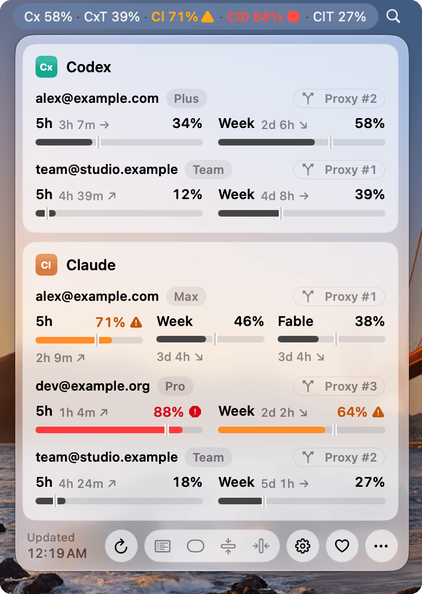
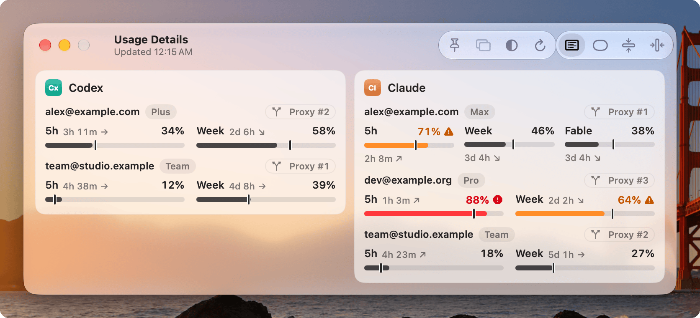
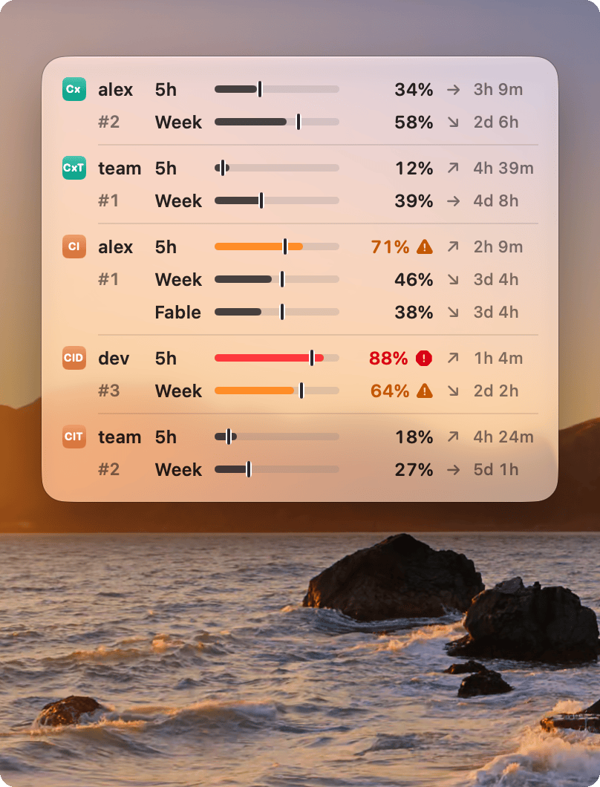
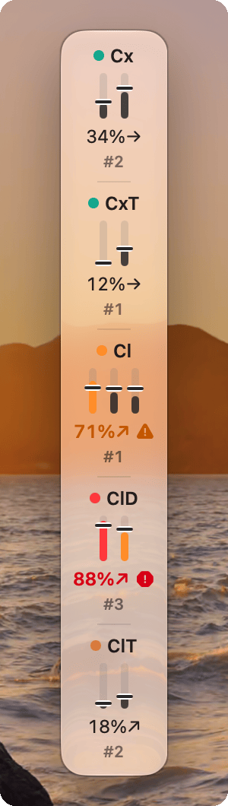

<a href="https://www.buymeacoffee.com/gilitos92">
  
</a>

# Allowance Bar

Your AI coding limits, always in sight. Allowance Bar is a small macOS menu
bar app that shows how much of each Codex, Claude, Cursor, Gemini and Muse
Code limit you have used, when it resets, and whether you are on pace, for
every account you have. It also shows Claude API spending and pay-as-you-go
balances.

<p align="center">
  <picture>
    <source media="(prefers-color-scheme: dark)" srcset="Resources/screenshot-dropdown-dark.png">
    
  </picture>
</p>

<p align="center">
  <a href="https://github.com/gilitos92/AllowanceBar/releases/latest"><b>Download for macOS</b></a>
  &nbsp;·&nbsp; macOS 14 or later &nbsp;·&nbsp; free and open source
</p>

## Highlights

- **Every account at a glance.** Personal, work and team accounts each get
  their own meters, grouped under one header per provider.
- **Pace, not just percent.** A marker on each bar shows where even use
  would be, and an arrow says whether you are ahead of pace (↗), on pace (→)
  or under it (↘).
- **Clear warnings.** Limits turn orange at 60% and red at 85%, always with a
  symbol, so color is never the only signal. Optional notifications warn
  before you run out.
- **Calm when a provider hiccups.** The last known numbers stay visible,
  dimmed, instead of an error in your menu bar.
- **Private by design.** Allowance Bar reads the logins your tools already
  have. Tokens never leave your Mac except to the provider's own API, and
  there is no telemetry.
- **Made for agents too.** A read-only CLI and an agent skill let your coding
  agents check their budget before a big task.

## Keep your limits on screen

Press ⌘D, or pick a view in the dropdown, to open a floating window that
stays above your work. On macOS 26 and later it is made of Liquid Glass.

<picture>
  <source media="(prefers-color-scheme: dark)" srcset="Resources/screenshot-details-dark.png">
  
</picture>

Switch to a smaller view when space is tight. The **Compact** view keeps one
row per limit, the **Nano** view keeps only the numbers, and the **Vertical
Nano** view stands on end along a side of the screen.

<p align="center">
  <picture>
    <source media="(prefers-color-scheme: dark)" srcset="Resources/screenshot-mini-dark.png">
    
  </picture>
  &nbsp;&nbsp;
  <picture>
    <source media="(prefers-color-scheme: dark)" srcset="Resources/screenshot-nano-vertical-dark.png">
    
  </picture>
</p>

<p align="center">
  <picture>
    <source media="(prefers-color-scheme: dark)" srcset="Resources/screenshot-nano-dark.png">
    
  </picture>
</p>

Hover the compact or nano panel to close it, keep it on top, show it on
every desktop, change its opacity or switch views. The window comes back the way you left it.

## Supported providers

| Shows | Providers |
|---|---|
| **Usage limits** | Codex · Claude Code · Cursor · Gemini · Muse Code · Antigravity |
| **Monthly spending** | Claude API |
| **Balances** | OpenRouter · DeepSeek · Kimi · Z.ai · Venice |

Each provider can be on, off, or shown only when it is found on your Mac.
Every provider supports several accounts. If you pool logins in
[CLIProxyAPI](https://github.com/router-for-me/CLIProxyAPI), each of its
Claude, Codex, Gemini and Antigravity logins shows up on its own, with its
place in the proxy's order.

[How each provider is read, and how to set them up](docs/PROVIDERS.md) ·
[Several accounts](docs/MULTIPLE_ACCOUNTS.md) ·
[Codex accounts](docs/CODEX_ACCOUNTS.md)

## Install

1. Download `AllowanceBar.zip` from the
   [latest release](https://github.com/gilitos92/AllowanceBar/releases/latest).
2. Unzip it and drag `Allowance Bar.app` to Applications.
3. Open it. The app is signed with a Developer ID and notarized by Apple.

The first time it reads a saved key, macOS may ask for access to the login
keychain; click **Always Allow**. After that, the app keeps itself up to
date with signed updates. To start it with your Mac, turn on **Launch at
Login** in Settings.

## Privacy

- Claude Code, Cursor and Gemini logins are read fresh on each refresh from
  where those tools keep them. Allowance Bar never writes
  them anywhere and sends them only to that provider's own API.
- For Codex and Muse Code, Allowance Bar asks your own CLI for the numbers
  and never sees a token. It never signs in for you.
- API keys you paste are stored only in your macOS Keychain and sent only to
  that provider. A dedicated, revocable key is recommended.
- With CLIProxyAPI, every token stays on the proxy's machine.
- No analytics, no telemetry, no accounts.

Details in [docs/PROVIDERS.md](docs/PROVIDERS.md) and
[SECURITY.md](SECURITY.md).

## For agents and scripts

Turn on **Settings → Agents → Enable agent & CLI access**, then use the
bundled command-line tool. It reads a snapshot of the numbers (never
credentials) that the app writes after each refresh.

```bash
allowancebar status          # a readable table
allowancebar status --json   # stable JSON for scripts and agents
allowancebar skill           # an agent skill for Codex, Claude Code and Cursor
```

Install the tool from **Settings → Agents**. The schema, the skill and the
security model are in [docs/AGENT_INTERFACE.md](docs/AGENT_INTERFACE.md).

## Build from source

```bash
swift build
swift test
scripts/bundle.sh --install   # builds "Allowance Bar.app" and copies it to /Applications
```

See [CONTRIBUTING.md](CONTRIBUTING.md) for the project layout and how to add
a provider.

## Support

If Allowance Bar saved you from a surprise rate limit, a coffee is always
appreciated, and entirely optional.

<a href="https://www.buymeacoffee.com/gilitos92">
  
</a>

## Credits

Allowance Bar is a fork of [AgentMeter](https://github.com/fdtorres1/AgentMeter)
by Felix Torres, released under the MIT License. It is an independent project,
not affiliated with or endorsed by the original author. If you like the
original, you can [support its author](https://www.buymeacoffee.com/fdtorres).
Endpoint formats were validated against
[CodexBar](https://github.com/steipete/CodexBar) by Peter Steinberger.

Allowance Bar speaks English and Spanish, following your macOS language.
Translations are welcome: every string lives in one
[String Catalog](Sources/AgentMeter/Resources/Localizable.xcstrings).

## License

MIT. See [LICENSE](LICENSE).
